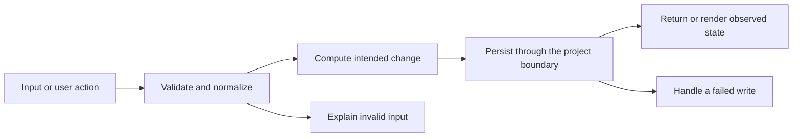

# Codebase map and reading order

[Course index](README.md)

## The problem this project solves

The local app persisted edits but had no validated application backup flow. A naive importer could replace good data before discovering that a later record was invalid. The improvement you will study is: The application section exports a versioned JSON backup and imports it as an explicitly labeled replacement. It validates field types, bounded lengths, ids, status, dates and URLs before writing. A failed parse or rejected host write leaves the displayed applications unchanged.

## Data model

The exchange format is {format: "daybook.jobs", version: 1, applications: [...]}. The stored application key remains jobtracker:data and contains an array. Calendar events use timetrack:events and are not part of this applications-only backup.

An object is a named collection of fields. An array is an ordered collection of values. An id answers “which record?”; an index answers “where is it in this array right now?” Those questions are different whenever the list can be filtered, reordered or edited. Persisted data is the form that must survive a process/page restart. Derived data can be recomputed from that persisted state.

## Trace one action

1. Export serializes the displayed applications with a versioned envelope.
2. Import reads a bounded JSON file.
3. parseJobBackup validates every application and rejects duplicate ids.
4. The operation joins the existing write queue.
5. commitJobBackup writes one complete application-array value.
6. Only a successful write replaces React state; calendar data is separate.

This diagram names responsibilities, not necessarily separate files. A small browser program can keep them in app.js. A larger API spreads them across controllers, services and models. Follow the actual sequence above rather than assuming every repository has the same architecture.

## Where to read first

1. [src/jobBackup.js](../src/jobBackup.js): locate `parseJobBackup` and read its inputs, branches and return/side effects.
2. [test/jobBackup.test.js](../test/jobBackup.test.js): read the scenario names before the helper code.
3. The root [README](../README.md): connect setup and the larger application workflow.

## Source navigation

- [src/App.jsx](../src/App.jsx)
- [src/JobTracker.jsx](../src/JobTracker.jsx)
- [src/calendar/CalendarHome.jsx](../src/calendar/CalendarHome.jsx)
- [src/dates.js](../src/dates.js)
- [src/jobBackup.js](../src/jobBackup.js)
- [src/main.jsx](../src/main.jsx)
- [src/storage.js](../src/storage.js)
- [src/theme.js](../src/theme.js)
- [vite.config.js](../vite.config.js)

## A practical reading technique

At each function boundary, write down the value coming in, the value going out and any side effect. A side effect includes a storage write, SQL query, network request, timer registration or DOM update. If a function calls another function, inspect only that next dependency until you can finish the chosen trace. Return to unrelated files later.

For this lesson, start with: **A backup with a valid Acme application followed by another record with the same id is rejected as a whole. The storage set function must not be called. A valid two-record backup is written once; importing it again still yields two records with their original ids.** Mark where the id, time, amount or other important value changes representation. For example, JSON serializes values into text; a date field may be a calendar string; SQL aggregates may return a different type from individual rows. Representation changes are common bug locations.

## Check your understanding

Without reading the solution, answer: Who owns the mutable state? Which input is untrusted? Which function first decides whether the operation is valid? What survives reload or restart? What observation would prove that the operation partially failed? Point to a source file for each answer, rather than describing a generic app from memory.
