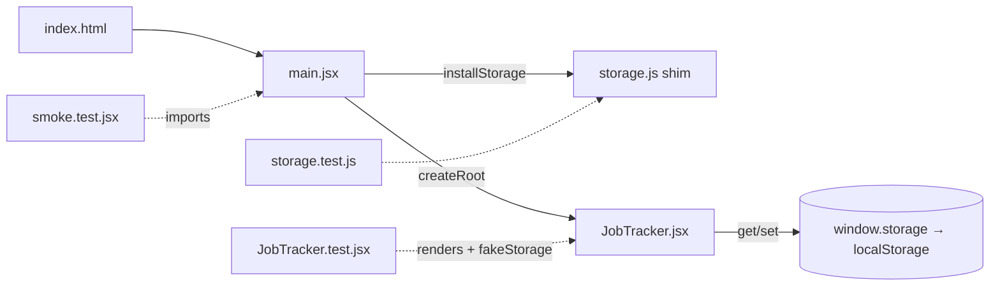

# System Map

## Shape

Single app, single package, no workspaces. Not a monorepo. The entire production
dependency graph is React + ReactDOM.

```
index.html ──loads──> src/main.jsx ──installs──> src/storage.js  (window.storage shim)
                          │
                          └──mounts──> src/JobTracker.jsx  (the whole app)
                                            │
                                            └──talks only to──> window.storage
test/ ─── renders JobTracker directly (unit/behavior) or boots main.jsx (smoke)
```



## Ownership map

| Concern | Lives in | Notes |
|---|---|---|
| UI (all of it) | [JobTracker.jsx#L381-L778](../../src/JobTracker.jsx#L381-L778) | Sub-components L381-L491, app component L495-L778 |
| Domain logic | [JobTracker.jsx#L84-L137](../../src/JobTracker.jsx#L84-L137) | Pure helpers: dates, tokens, predicates |
| State | [JobTracker.jsx#L496-L505](../../src/JobTracker.jsx#L496-L505) | Nine `useState` hooks, all local |
| Persistence | [JobTracker.jsx#L508-L538](../../src/JobTracker.jsx#L508-L538) + [storage.js](../../src/storage.js) | Load effect + `persist`; shim owns the localStorage detail |
| Styling | [JobTracker.jsx#L19-L82](../../src/JobTracker.jsx#L19-L82), [L141-L379](../../src/JobTracker.jsx#L141-L379) | Tokens, CSS string, style objects |
| Boot | [main.jsx](../../src/main.jsx) | Shim first ([L7](../../src/main.jsx#L7)), then mount |
| Tests | [test/](../../test) | Behavior, contract, smoke — see [05-quality-engineering](../05-quality-engineering/01-testing-strategy.md) |
| Build/test config | [vite.config.js](../../vite.config.js), [package.json](../../package.json) | |
| Intent | [SPEC.md](../../SPEC.md) | The written contract the code was built to |

## Public interface vs private internals

This app's **public surface** is unusually honest — there are exactly two contracts:

1. **`window.storage`** — the persistence API the component *consumes*:
   `get(key) → {value}` (rejects when absent), `set(key, value)`. Defined by usage at
   [JobTracker.jsx#L512](../../src/JobTracker.jsx#L512) and [L533](../../src/JobTracker.jsx#L533),
   implemented at [storage.js#L16-L34](../../src/storage.js#L16-L34), pinned by tests at
   [storage.test.js#L9-L33](../../test/storage.test.js#L9-L33).
2. **The stored data shape** — a JSON array of `{id, company, stack, date, notes}` under
   key `jobtracker:data` ([L15](../../src/JobTracker.jsx#L15)). This is a contract with
   *your own past self*: any change must still parse what old sessions wrote.

Everything else — helpers, sub-components, style objects — is private. A senior habit:
on any repo, ask first "what are the contracts, and who is on the other side of each?"
Here the other sides are (1) the host environment and (2) previously persisted data.
That second one is the sneaky one; it's why schema changes are the riskiest edit in this
repo (see [03/02-data-model-and-persistence.md](../03-architecture-and-patterns/02-data-model-and-persistence.md)).

## What a junior misreads on this map

- Thinking `storage.js` is "the backend." It's an *adapter*. The component doesn't know
  localStorage exists — check that `localStorage` appears nowhere in
  [JobTracker.jsx](../../src/JobTracker.jsx)'s *code* (its one mention, [L12](../../src/JobTracker.jsx#L12),
  is a doc comment pointing at the shim).
- Thinking the two tabs are two features. They're one dataset with two projections
  ([L592-L598](../../src/JobTracker.jsx#L592-L598)).

## Drill

Draw this map from memory (boxes and arrows, 5 minutes). Then diff against the diagram
above. Self-grade — **Basic:** got the four source files. **Solid:** got the arrows'
directions right, including "component → window.storage, never localStorage."
**Strong:** drew the *contracts* as first-class boxes and could say who's on each side.
